# PageLingo · AI 网页翻译

原生 Chrome Manifest V3 扩展。配置你自己的 AI API Key，点击扩展图标即可翻译当前网页。无需构建、无需服务器、无需安装运行依赖。

## 界面预览

午夜深色为默认主题。下面逐页展示全部配置页面、插件弹窗与翻译浮窗；截图使用正式界面和演示数据，不包含真实 API Key，也不会向 AI 服务发送请求。

### 午夜深色 · 全部页面详细截图

**01 · AI 服务商**

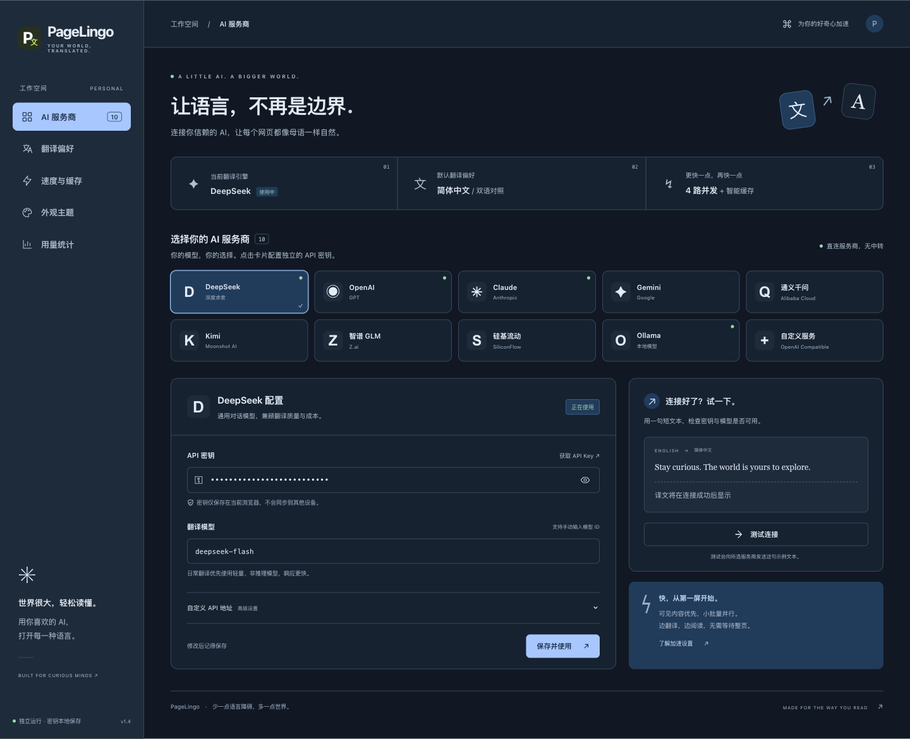

**02 · 翻译偏好**

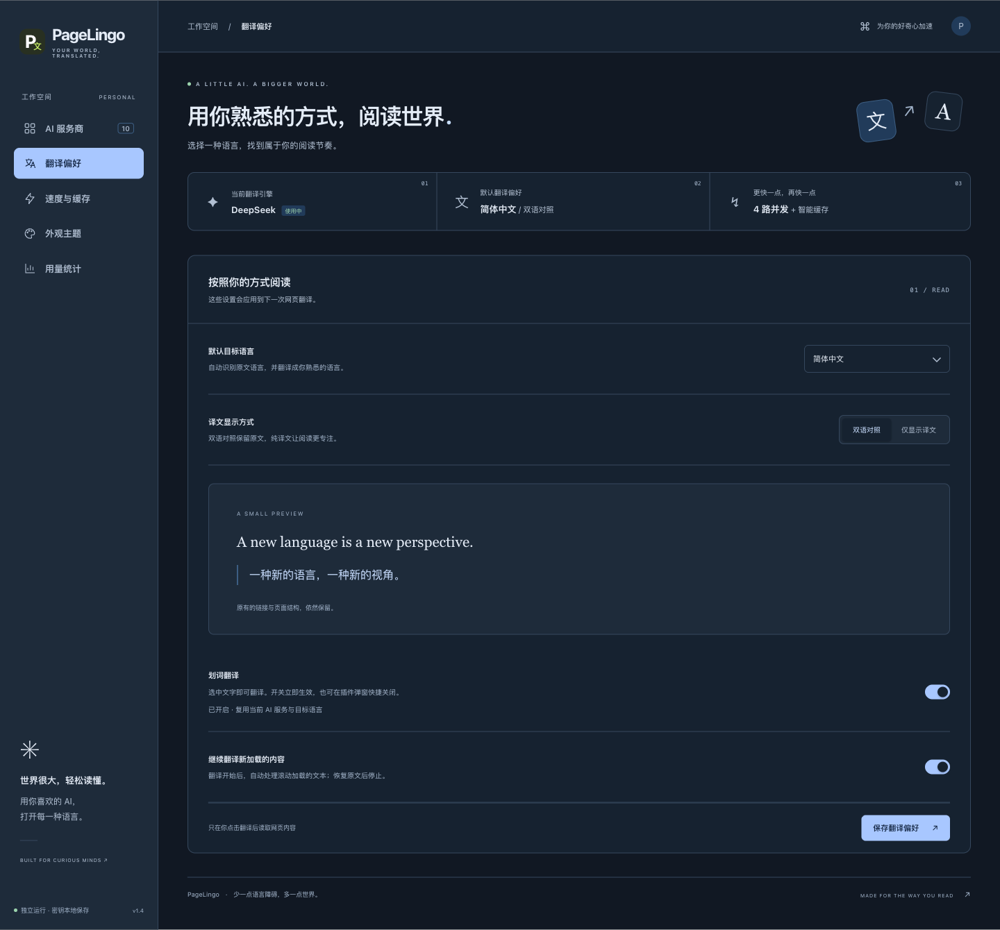

**03 · 速度与缓存**

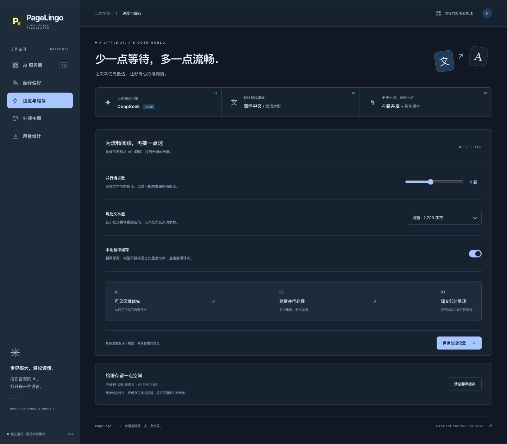

**04 · 外观主题**

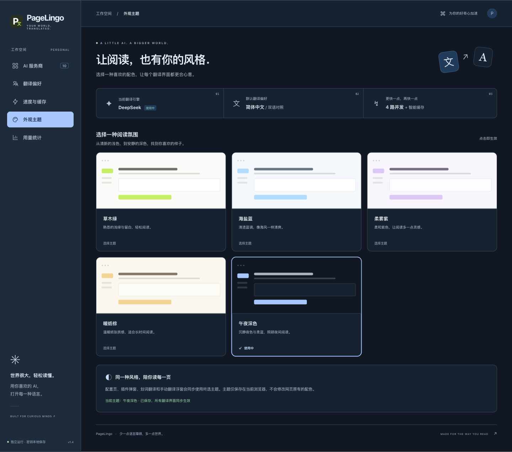

**05 · 用量统计**

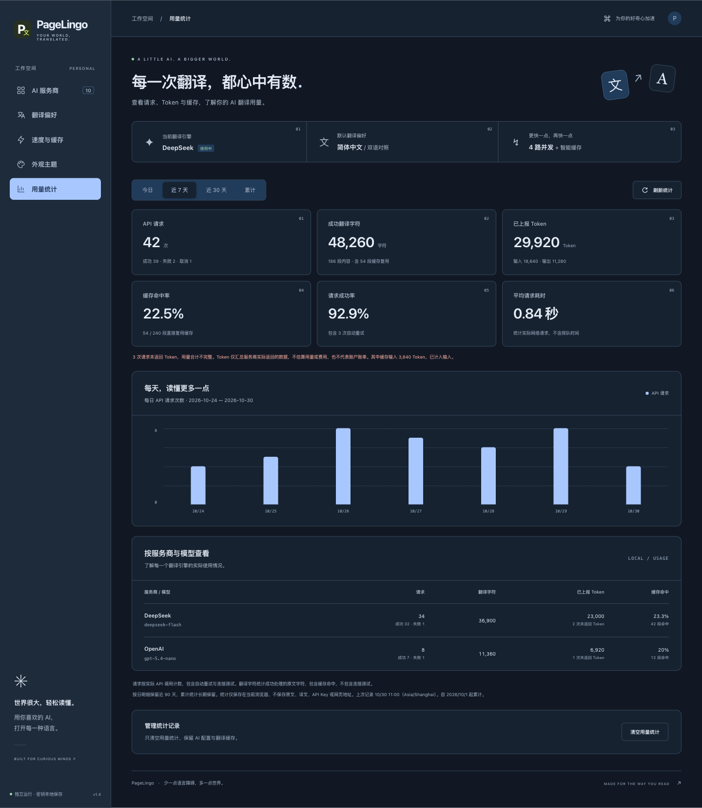

**06 · 插件弹窗**

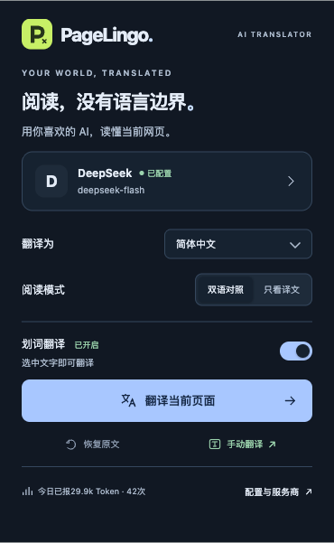

**07 · 手动翻译浮窗**

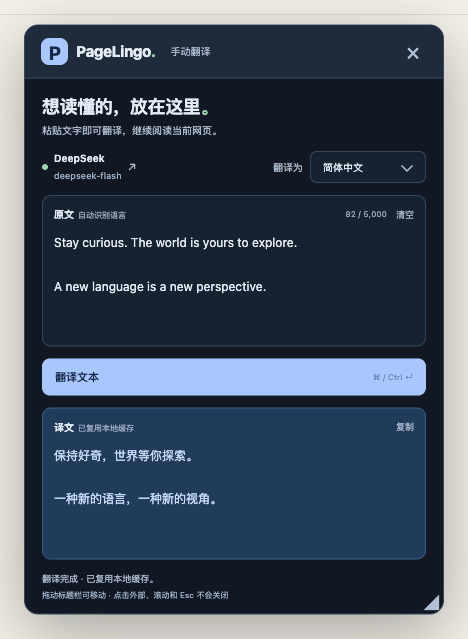

**08 · 划词翻译**

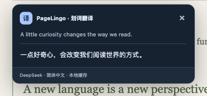

**09 · 整页翻译工具栏**

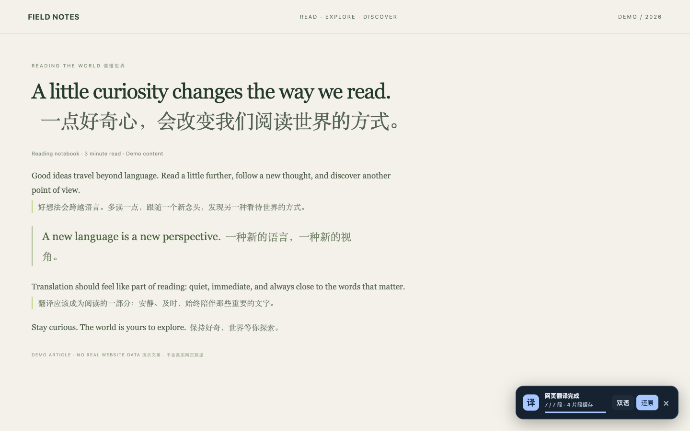

工具栏近景：

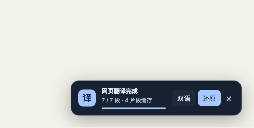

**10 · 独立翻译兼容页**

保留的独立翻译页面仅用于兼容；当前「手动翻译」入口在原网页显示浮窗，不会打开新标签页。

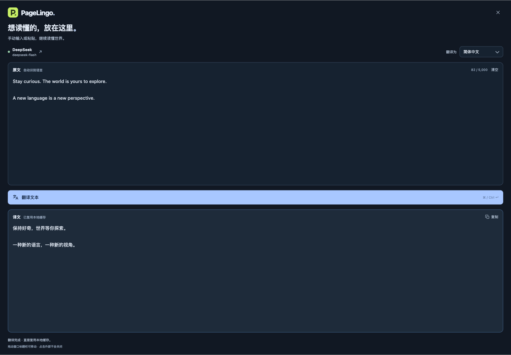

### 其他主题 · 全部页面拼图

每张总览图都包含上面十个界面。点击缩略图可打开整张高清拼图；可在配置页的「外观主题」中切换。

<table>
  <tr>
    <td align="center"><a href="screenshots/themes/sage/overview.png">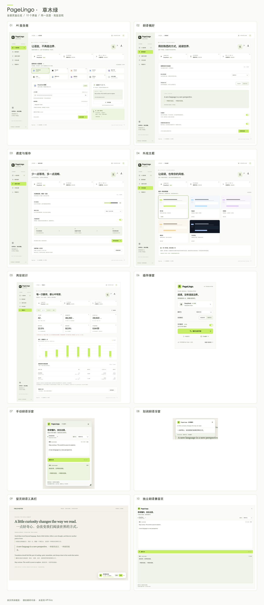</a><br><strong>草木绿 · 全部页面</strong></td>
    <td align="center"><a href="screenshots/themes/ocean/overview.png">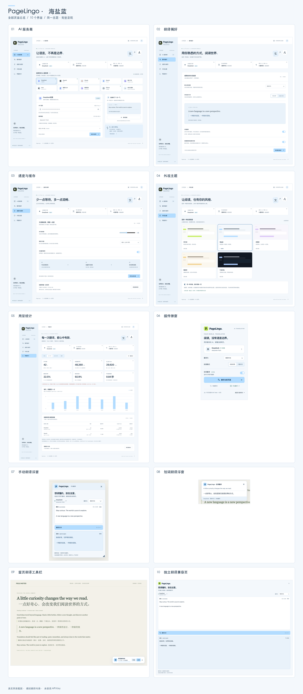</a><br><strong>海盐蓝 · 全部页面</strong></td>
  </tr>
  <tr>
    <td align="center"><a href="screenshots/themes/lavender/overview.png">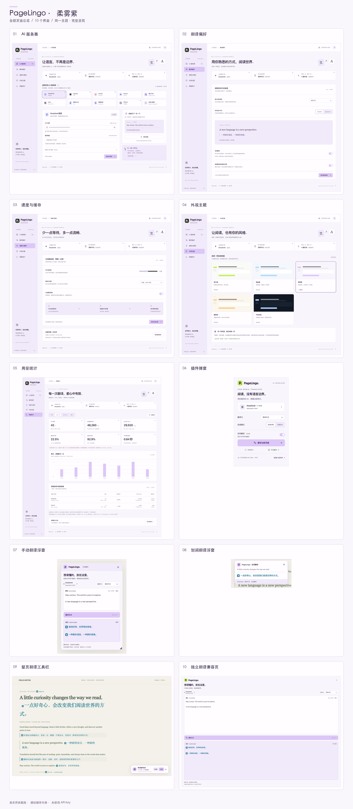</a><br><strong>柔雾紫 · 全部页面</strong></td>
    <td align="center"><a href="screenshots/themes/sand/overview.png">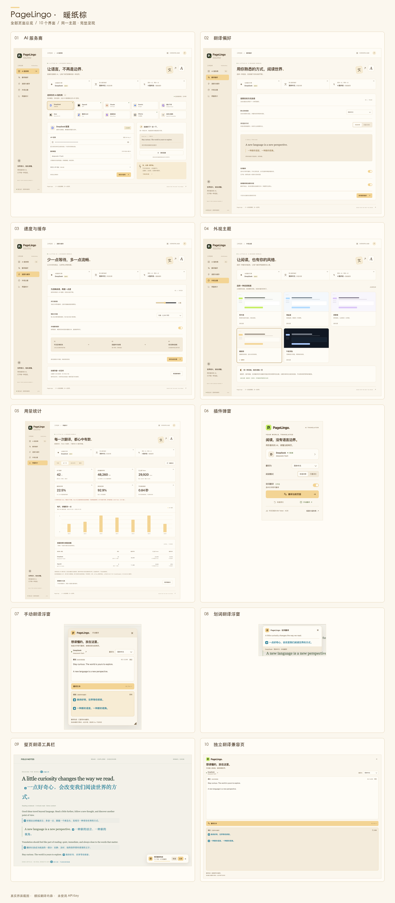</a><br><strong>暖纸棕 · 全部页面</strong></td>
  </tr>
</table>

## 安装到 Chrome

1. 在 Chrome 地址栏打开 `chrome://extensions`。
2. 打开右上角「开发者模式」。
3. 点击「加载已解压的扩展程序」，选择当前 `PageLingo` 目录（包含 `manifest.json` 的这一层）。也可以使用 `npm run package` 生成的 `dist/PageLingo-1.4.0` 目录。
4. 在打开的配置页选择服务商，填写 API Key 和模型，点击「保存并使用」。Chrome 会只请求该 API 域名的访问权限。
5. 可点击「测试连接」查看示例译文和本次实际耗时。之后打开一个普通网页，点击扩展图标 →「翻译当前页面」。

支持 DeepSeek、OpenAI、Claude、Gemini、通义千问、Kimi、智谱 GLM、硅基流动、Ollama，以及兼容 OpenAI Chat Completions 的自定义接口。模型 ID 可自行填写，以你的服务商账户实际开放的模型为准。

默认翻译为简体中文，双语显示。支持 12 种目标语言、纯译文模式和一键恢复原文。恢复时保留原有链接、元素身份和文字；翻译期间网页自行更新的文字不会被旧原文覆盖。

## 划词翻译

在扩展弹窗的「阅读模式」下方打开「划词翻译」，首次开启时允许 Chrome 请求的网页访问权限。之后在普通网页上选中文字，译文会显示在文字旁，复用当前 AI 服务、模型和目标语言。支持鼠标划选与键盘选区；最多翻译 5,000 字符，不修改原文。

弹窗和配置页「翻译偏好」均可切换此功能，关闭后所有已打开的标签页立即停止划词翻译、取消未完成的划词请求并收起结果。该开关与整页翻译独立。滚动页面或内部滚动区域时，翻译框固定保留在屏幕上，未完成的请求也会继续；调整窗口大小时自动限制在可见区域内。按 Escape、点击关闭按钮、点击空白或选择新的文字可收起或替换当前结果。

划词翻译默认关闭，授权后会在新打开的网页中自动可用，无需每次打开弹窗。支持手动划选只读代码块中的单词或文字，译文显示在浮窗中，代码本身保持不变。输入框、密码框、表单、编辑区域、隐藏内容及 `translate="no"` 区域不会用于划词翻译。API Key 始终只在扩展后台使用。

更新本地代码后，需在 `chrome://extensions` 点击 PageLingo 的重新加载按钮，再重新打开弹窗或配置页。只刷新配置页面不会让 Chrome 重新读取 Manifest。若加载的是打包目录，确认使用 `dist/PageLingo-1.1.0` 或更新版本，而非旧的 `dist/PageLingo-1.0.0`；旧版缺少划词所需的 HTTP 全站权限声明，会提示“只能申请 Manifest 已声明的权限”。

## 手动翻译小窗

在扩展弹窗的「恢复原文」旁点击「手动翻译 ↗」，直接在当前普通网页内显示浮窗，不新开标签页或浏览器窗口。遇到网页禁止划选、代码编辑器或其他无法触发划词的内容，可以自行复制文字粘贴到这里，选择目标语言后翻译。每次最多输入 5,000 个 Unicode 字符，支持 `Ctrl / ⌘ + Enter` 翻译、取消请求、一键复制译文和清空内容。

拖动浮窗顶部标题栏可移动，浮窗大小受当前可视区域限制。点击外部、滚动、切换标签页或按 Escape 不会让它自动关闭；在同一页面再次点击入口会唤起已有浮窗，保留其中的输入与结果。点击右上角「关闭」才会收起；刷新或离开当前网页会随文档销毁浮窗。输入不保存为草稿，关闭后重新打开为空；开启缓存时，译文仍按本地缓存策略保留，可在配置页清空。

手动翻译使用已保存的 AI 服务和模型，不依赖划词开关。点击扩展图标时，通过已有的 `activeTab` 与 `scripting` 权限在当前网页显示浮窗，无需为此开启所有网站访问权限；仍需先在配置页保存 Key、模型并授权访问该 AI 服务。目标语言可在浮窗中单独选择，不修改整页翻译偏好。修改输入或语言会停止旧请求，旧译文会标记为需要重新翻译，防止把旧结果当作新结果。

翻译会复用本地缓存、后台并发限制与用量统计。输入内容在你点击翻译或使用翻译快捷键后，才会发给所选 AI 服务；不会自动读取剪贴板或当前网页。关闭浮窗会取消尚未完成的请求，已经发送到服务商的请求仍可能产生用量。Chrome 内部页、扩展商店和部分内置阅读器禁止注入，入口会提示在普通网页打开后粘贴内容，不会自动打开其他页面。

## 外观主题

在配置页左侧打开「外观主题」，可选择草木绿、海盐蓝、柔雾紫、暖纸棕或午夜深色。点击主题预览卡立即生效并自动保存，配置页、插件弹窗、整页翻译工具栏、划词翻译与手动翻译浮窗会同步更新。

主题只保存在当前浏览器，不修改网页原有的配色。切换时保留浮窗输入、已有译文和进行中的翻译，不覆盖 API Key 或未保存的表单。新安装及没有主题字段的旧配置默认使用午夜深色；已保存的主题选择保持不变，无需重新配置服务商。

## 用量统计

弹窗底部显示今日已知 Token 和请求次数，点击进入配置页的「用量统计」。可切换今日、近 7 天、近 30 天和累计，查看每日请求趋势、翻译字符数、缓存命中率、成功率、平均请求耗时，以及各服务商和模型的用量。

- 请求次数按实际 API 调用计数，包括失败、取消、重试和连接测试。缓存命中不增加请求或 Token，同一会话内合并的请求只计一次；重试等待时间不计入平均请求耗时。
- 翻译字符数按成功处理的原文字符累计，包含本地缓存返回的内容和重复翻译，不包含连接测试；Emoji 等 Unicode 字符计为一个字符。缓存命中率按成功返回的翻译片段计算。
- Token 使用 OpenAI 兼容接口、Claude、Gemini 响应中的真实用量，包含服务商上报的推理消耗；服务商的输入缓存 Token 已包含在输入总量中，不重复相加。本地翻译缓存与服务商输入缓存分别统计。接口未返回用量时标记为缺少数据，不按字数估算，不代表完整账单或实际费用。
- 更新到本版本后开始记录，历史用量不会补录。数据只存储在本机，按首次记录时的浏览器时区分日；每日明细保留最近 90 天，累计总数持续保留。每个汇总最多保留 199 个独立服务商/模型组合，超出的合并为「其他模型」。统计存储预算为 4 MiB，接近预算时将较早的每日模型明细合并为「其他」并在页面说明，日总量与累计总量保留。
- 可在统计页清空统计，清空不会删除 API Key、翻译偏好或翻译缓存。统计不保存原文、译文、网页 URL 或密钥，写入失败不会阻塞翻译。

## 速度设计

- **先读第一屏**：可见内容优先；首批控制在约 700 字符（单个长文本可能更大）。
- **多路并行**：默认 4 路，可调为 1–8 路；所有标签页共享后台并发上限。
- **批量处理**：默认每批 2,200 字符、最多 12 个片段，长文本分段。译文逐批显示，不等待整页完成。
- **重复内容复用**：同一翻译会话内合并相同文本的请求；缓存命中绕过网络队列。
- **持久缓存**：按服务商、API 地址、模型、目标语言和原文哈希隔离。最多约 2,000 条 / 12 MB，30 天过期，定期回收。
- **减少推理等待**：对已确认支持的服务关闭推理模式；默认优先轻量模型。
- **有界等待**：单次请求 25 秒超时；429 / 5xx 最多重试一次，可恢复原文并取消请求。

没有固定的「整页几秒」保证。实际耗时由网页长度、模型、网络和服务商限流决定。先用默认 4 路；频繁出现 429 时降低并发。连接测试仅测一句文本，不能代表整页耗时。

## 本地模型与其他服务

Ollama 默认地址 `http://localhost:11434/v1`，密钥可留空，模型填写本机已拉取的模型名。需先运行 Ollama 并下载相应模型。本机性能决定生成速度。

火山引擎 / 豆包可选择「自定义服务」，API 地址填写 `https://ark.cn-beijing.volces.com/api/v3`，模型填写已开通的模型或推理接入点 ID。其他 OpenAI 兼容服务同理。自定义接口必须返回标准 Chat Completions 格式，并遵循 JSON 段落输出要求。

## 数据与权限

API Key 存储在 `chrome.storage.local`，不做跨设备同步、不经过 PageLingo 服务器。它不是加密保险库；能访问此浏览器配置文件的人可能读取密钥。内容脚本无法读取保存 Key 的存储区域，网页只会收到译文和公开配置。

整页翻译只在你主动点击翻译后读取当前页的可见文本，并跳过代码块；划词翻译只在开启功能并选中文字后发送选区文本，包括你主动选中的代码文字。文字直发所选 AI 服务，不发送页面 URL、表单字段或隐藏内容。可选的动态翻译在本次整页翻译开始后处理新加载的文本，恢复原文后停止。

缓存仅在当前浏览器的 IndexedDB 中保留译文与原文哈希，不保存明文原文。敏感页面可关闭缓存；配置页的「速度与缓存」可清空缓存。删除服务商 Key 时，清空密钥输入框并保存即可。

首次安装仅申请 `storage`、`activeTab` 和 `scripting`。API 域名权限在保存或测试时按需授权；不会在安装时申请读取所有网页。

开启划词翻译时，才会按需申请 HTTP / HTTPS 网页访问权限，用于在当前与新打开的页面中处理选区。关闭开关会停用监听和自动注入；Chrome 已授予的域名权限保留，避免影响整页翻译的 API 访问。可在 Chrome 扩展详情中管理网站访问权限。

## 支持范围

整页与划词翻译面向普通 HTTP / HTTPS 网页的主文档文本。Chrome 内部页面、扩展商店、PDF 内置阅读器、iframe 内文和 Shadow DOM 内文暂不支持直接读取，可复制文字到普通网页的手动翻译浮窗。图片中的文字不识别。整页翻译一次最多收集 6,000 个文本节点 / 50 万字符；达到上限会在工具栏提示。

双语模式在原文旁插入文本片段，保留链接结构；包含很多行内元素的句子可能会分片翻译。这是当前版本在页面结构保留与上下文完整性之间的取舍。

## 开发与验证

```sh
npm run dev     # 只在本机 http://127.0.0.1:4173 预览配置 UI
npm run check   # 检查 Manifest、引用资源、CSP、UI 绑定和 JS 语法
npm test        # Node 内置测试运行器，无第三方依赖
npm run package # 生成解压目录和 ZIP 安装包
```

普通浏览器预览会明确标识为预览，保存的预览配置与实际扩展配置隔离；翻译和连接测试必须在已加载的扩展中使用。不要在共享的预览网页中输入真实密钥。

`tests/browser.html` 提供真实 DOM、MutationObserver 与渲染流程的浏览器测试，使用模拟服务，不会连接 AI 服务或使用真实 Key。自动化测试涵盖三种 API 协议、批次编号校验、超时、重试、取消、缓存、权限边界和 DOM 保留。真实服务需要用户 Key 才能验证，本仓库不包含任何 Key。

`tests/selection-browser.html` 提供划词翻译的真实 Selection / Range 集成测试，同样使用模拟模型响应。

`tests/popup-layout.html` 使用正式弹窗界面与模拟配置，检查开启、关闭和重复切换划词开关时的尺寸、按钮位置与滚动条是否稳定。

`tests/usage-browser.html` 使用正式配置页面和模拟统计数据，检查时间筛选、汇总、刷新、错误恢复和清空确认，不连接真实 AI 服务。

`tests/manual-browser.html` 使用正式手动翻译界面与模拟接口，检查输入限制、翻译、取消、迟到响应、复制和窗口持久显示，不使用真实 Key。

`tests/manual-floating-browser.html` 在普通网页直接运行正式浮窗脚本，检查不打开窗口或标签页、重复唤起、拖动、关闭与取消，以及翻译和输入状态保留。

`tests/theme-browser.html` 使用正式配置页、弹窗和网页浮窗，检查五套主题的保存与同步、深色对比度、弹窗布局，以及切换时输入、译文与进行中请求的保留。测试只使用模拟配置与翻译，不连接 AI 服务。

`tests/theme-gallery.html?theme=midnight` 加载同一主题的全部十个正式界面，页面中的「下载裁切坐标」可导出布局信息。通过浏览器导出完整长图后，使用 `scripts/compose-theme-screenshots.py` 和 Pillow 裁切逐页截图、生成其他主题的全部页面拼图；截图与统计均为演示数据。

## 开源许可证

本项目采用 [MIT 许可证](LICENSE)，允许使用、修改和商业使用；分发时请保留版权声明和许可证文本。

## API 参考

- [OpenAI Chat Completions](https://developers.openai.com/api/reference/resources/chat/subresources/completions/methods/create)
- [DeepSeek API](https://api-docs.deepseek.com/api/create-chat-completion/)
- [Claude Messages](https://platform.claude.com/docs/en/api/messages)
- [Gemini API](https://ai.google.dev/api/generate-content)
- [Chrome activeTab](https://developer.chrome.com/docs/extensions/develop/concepts/activeTab)
- [Chrome 动态内容脚本与可选权限](https://developer.chrome.com/docs/extensions/reference/api/scripting)、[权限申请](https://developer.chrome.com/docs/extensions/reference/api/permissions)
- [Ollama OpenAI compatibility](https://docs.ollama.com/api/openai-compatibility)
